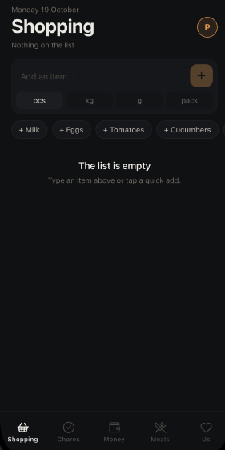
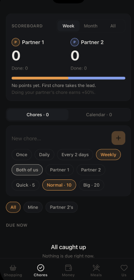
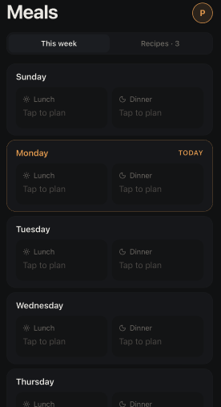

# 🏡 HomeSync — Real-Time Household Management for Couples


A multi-platform household companion app built with **React Native (Expo)**, **TypeScript**, and **Firebase Firestore**, designed to streamline domestic life, chores, groceries, meal planning, and couple activities with live real-time cloud sync.

---

## 📱 App Preview

<div align="center">
  <table>
    <tr>
      <td align="center"><b>Smart Grocery List</b></td>
      <td align="center"><b>Chores & Shared Calendar</b></td>
      <td align="center"><b>Weekly Meal Planner</b></td>
      <td align="center"><b>Date Roulette & Home Hub</b></td>
    </tr>
    <tr>
      <td></td>
      <td></td>
      <td></td>
      <td></td>
    </tr>
  </table>
</div>

---

## ✨ Key Features

### 🛒 1. Smart Grocery Shopping
* **Instant Auto-Categorization:** Automatically categorizes items (Produce, Dairy, Meat, Pantry, Bakery, Household) using local keyword heuristic tagging.
* **Dual-State Cart:** Strike-through marking with one-tap batch clearing of checked items.
* **Sync-to-Cart:** One-click transfer of ingredients from custom recipes directly to the active shopping list.

### 🧹 2. Chores & Shared Calendar
* **Smart Recurrence Engine:** Supports one-time, daily, every-2-days, and weekly recurring cycles. Completing a recurring chore automatically reschedules the next due date without manual reset.
* **Assignee Ownership:** Assign chores to *Me*, *Partner*, or *Both* with color-coded badges.
* **Shared Event Timeline:** Joint event tracking with real-time countdown badges.

### 🍲 3. Meals & Recipe Book
* **Weekly Meal Grid:** Full 7-day schedule supporting lunch and dinner planning.
* **Built-in & Custom Recipes:** Integrated recipe catalog with custom ingredients, prep times, and immediate grocery export.

### 🎲 4. Date Roulette & Couple's Home Hub
* **Date Wheel:** Randomizer combining custom bucket-list ideas and built-in activity presets (Dining, Home, Outdoor).
* **Live Shared Love Note:** Synchronized digital chalkboard for sweet messages and daily reminders.
* **Household Teamwork Metric:** Live statistics showing active chores and completed tasks accomplished together.

---

## 🌐 Comprehensive Internationalization (i18n)

HomeSync supports 3 languages with seamless dynamic switching and text direction management:
* 🇮🇱 **Hebrew (עברית)** — Full RTL layout and typography.
* 🇷🇺 **Russian (Русский)** — Native localized strings.
* 🇬🇧 **English** — Global default interface.

---

## 🛡️ Security & Row-Level Protection

* **Row-Level Boundary:** Strict authenticated access across all 7 Firestore collections via `firestore.rules`.
* **Environment Protection:** Firebase keys are fully isolated via `process.env.EXPO_PUBLIC_*` and excluded from git tracking via `.gitignore`. A clean template is provided in `.env.example`.

---

## 🏗️ Architecture & Tech Stack

* **Framework:** React Native with Expo SDK (Managed Workflow, Expo Router v4).
* **Language:** TypeScript.
* **Database & Cloud:** Firebase Firestore (Real-time snapshot listeners).
* **UI Design System:** Custom OLED Pure Black theme (`#07080B`), Glassmorphism cards (`#11131A`), and Emerald Accent styling.
* **Haptics & Icons:** `expo-haptics`, `lucide-react-native`.

---

## 🚀 Getting Started

### 1. Clone the repository
```bash
git clone [https://github.com/RobertTonikyan/HomeSync.git](https://github.com/RobertTonikyan/HomeSync.git)
cd HomeSync/homesyn
