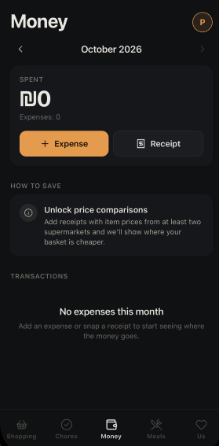
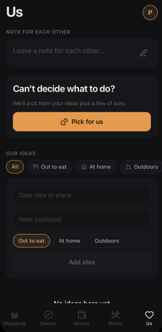

# HomeSync

**A shared home app for couples.** Shopping, chores, money, meals and date ideas, synced live between both phones.


<table>
  <tr>
    <td align="center"><br/><sub><b>Shopping</b></sub></td>
    <td align="center"><br/><sub><b>Chores</b></sub></td>
    <td align="center"><br/><sub><b>Money</b></sub></td>
  </tr>
  <tr>
    <td align="center"><br/><sub><b>Receipts</b></sub></td>
    <td align="center"><br/><sub><b>Meals</b></sub></td>
    <td align="center"><br/><sub><b>Us</b></sub></td>
  </tr>
</table>

---

## What's new in 2.0

- **New design.** Refined dark interface: graphite surfaces, one warm accent, a colour for each partner.
- **Hebrew, English and Russian**, switchable instantly. Hebrew is fully right-to-left.
- **Money tab.** Expenses, receipts with photos and item prices, a monthly summary, budget and "who owes whom".
- **Cheapest supermarket.** HomeSync compares prices from your own receipts and tells you where today's list costs less.
- **Chores as a friendly competition.** Points, a +50% bonus for taking over your partner's chore, a weekly scoreboard and streaks.
- **Security.** Anonymous sign-in plus Firestore rules that only let household members see household data.

## Features

### Shopping
A shared list grouped by aisle, with quick-add favourites and units. When you're done, **Add receipt** turns everything you checked into a receipt, so you only type the prices.

### Cheapest supermarket
Once you have receipts from two or more chains, the shopping screen shows which one is cheaper **for the list you have right now**: by how much, and on how many items. Tap it to see the price of each item, store by store.

### Chores
- Real due dates for one-time, daily, every-2-days and weekly chores
- Points by effort: quick 5 · normal 10 · big 20
- Doing your partner's chore is a **rescue** and earns +50%
- Weekly, monthly and all-time scoreboard, streaks, last week's champion and an activity feed
- Mark a chore as done by you or by your partner, reassign it, or undo
- Shared calendar for events

### Money
- Expenses by category, who paid, store and notes
- Receipts: a compressed photo plus item lines with prices
- Monthly total compared with last month, and an optional monthly budget
- Who paid what, and how much to transfer to split it evenly
- **Savings tips computed from your own data**: budget pace, categories that jumped, eating out, the cheaper store, small purchases that add up

### Meals
A weekly lunch and dinner plan, built-in and personal recipes, and one tap to send ingredients to the shopping list.

### Us
A shared note for each other, a list of date ideas, and a "pick for us" button.

---

## Getting started

```bash
git clone https://github.com/RobertTonikyan/HomeSync.git
cd HomeSync
npm install
cp .env.example .env
npx expo start
```

### 1. Firebase project
1. Create a project at [console.firebase.google.com](https://console.firebase.google.com) and add a **Web app**. Copy its config values into `.env`.
2. **Firestore Database**: create it (production mode).
3. **Authentication → Sign-in method → enable Anonymous.**
4. **Firestore → Rules**: paste the contents of [`firestore.rules`](firestore.rules) and publish.

### 2. Household ID
Both phones share data through `EXPO_PUBLIC_HOUSEHOLD_ID`. **Anyone who knows it can join your household**, so make it long and random:

```bash
node -e "console.log('HS-' + require('crypto').randomBytes(12).toString('hex'))"
```

Put the same value in `.env` on both phones.

### 3. Run
```bash
npx expo start -c
```
On first launch, each phone picks a language, enters both partners' names, and chooses whose phone it is.

---

## Security

| Area | How it's handled |
|---|---|
| Secrets | Firebase config lives only in `.env`, which is git-ignored. Nothing secret is committed. |
| Authentication | Every device signs in anonymously. Unauthenticated requests are rejected. |
| Authorisation | Firestore rules allow reading and writing a household's data only for devices listed in `households/{id}.memberUids`. A device can add only its own uid. |
| Data integrity | Documents can't be moved to another household. Text lengths, amounts, points and photo sizes are validated in the rules. |
| Photos | Receipt photos are compressed on the phone (≤ ~700 KB) and stored in a separate, member-only collection. |
| Local storage | Only the chosen language and "whose phone" are stored on the device. |

**Recommended in production:** restrict the Firebase API key to your app in Google Cloud Console, and enable [Firebase App Check](https://firebase.google.com/docs/app-check) to block requests that don't come from your app.

---

## Project structure

```
app/
  (tabs)/            shopping · chores · money · meals · us
  welcome.tsx        first-run setup
  settings.tsx       language, identity, names, budget
  expense.tsx        add / edit an expense or receipt
components/ui.tsx    design-system components (direction-aware)
constants/           theme, translations, categories, built-in content
context/AppContext   Firestore sync and actions
lib/                 pure logic: dates, prices, insights, competition
services/firebase.ts Firebase init, anonymous auth, household membership
firestore.rules      security rules
```

## Tech stack

React Native 0.86 · Expo SDK 57 · Expo Router · TypeScript · Firebase Auth + Firestore · lucide icons

## License

[MIT](LICENSE) © 2026 Robert Tonikyan
